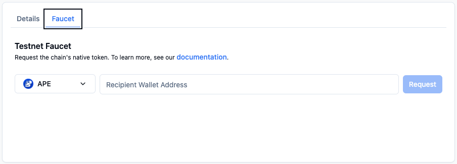

import { Callout } from 'nextra/components'

# Faucets

## Caldera

<Callout type="info">**Blue** is ApeChain's new testnet. It runs alongside Curtis for now, and Curtis will be deprecated in the coming weeks.</Callout>

To request funds from the ApeChain testnet faucet: 
1. Navigate to the *Faucet Section* on the [Blue Hub Page](https://apechain-tnet.hub.caldera.xyz/) (or the [Curtis Hub Page](https://curtis.hub.caldera.xyz/) for Curtis)
2. Enter your wallet address
3. Click the **Request** button

After a few seconds, you will see a deposit of Testnet APE in your wallet!

<Callout type="info">The current limit when requesting from the Caldera faucet is 1 APE</Callout>

