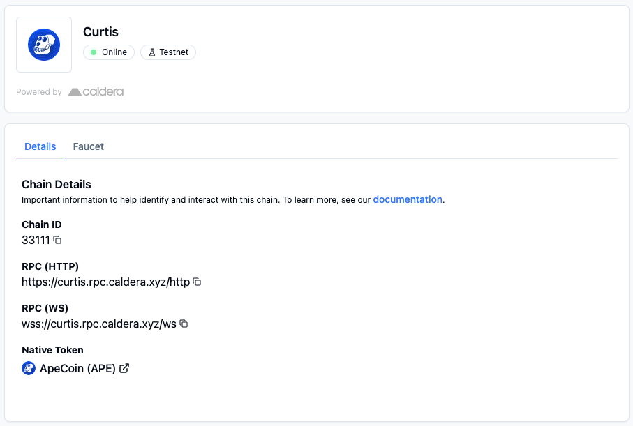

import { Callout } from 'nextra/components'

# Add ApeChain to Metamask

## Using the ApeChain Hub Page
<Callout type="info">**Blue** is ApeChain's new testnet. It runs alongside Curtis for now, and Curtis will be deprecated in the coming weeks.</Callout>

1. Navigate to the hub for [Blue Testnet](https://apechain-tnet.hub.caldera.xyz/), [Curtis Testnet](https://curtis.hub.caldera.xyz/) or [Mainnet](https://apechain.hub.caldera.xyz/)
2. Click the 
**Connect** button in the *Your Wallet* section, and you will be prompted to switch to the ApeChain Network

<Callout>When you click on the Connect button, please check the wallet extension icon and ensure you grant access to switch networks.</Callout>

{/*  */}

## Manually add to your Metamask wallet
You can add the network with the following details:

| Mainnet     | Details|    
| :------------ | :---------: 
| Network Name | ApeChain |
| RPC URL        |   https://rpc.apechain.com/http |
| Chain ID    |    33139   |   
| Currency Symbol|         APE    |
| Block Explorer| https://apescan.io/|
  

| Blue Testnet      | Details|    
| :------------ | :---------: 
| Network Name | Blue |
| RPC URL        |    https://rpcblue.apechain.com/   |
| Chain ID    |    3313939   |   
| Currency Symbol|         APE    |
| Block Explorer| https://blue.apescan.io/ |
  

| Curtis Testnet (deprecating soon)      | Details|    
| :------------ | :---------: 
| Network Name | Curtis |
| RPC URL        |    https://curtis.rpc.caldera.xyz/http   |
| Chain ID    |    33111   |   
| Currency Symbol|         APE    |
| Block Explorer| https://curtis.apescan.io/ |

