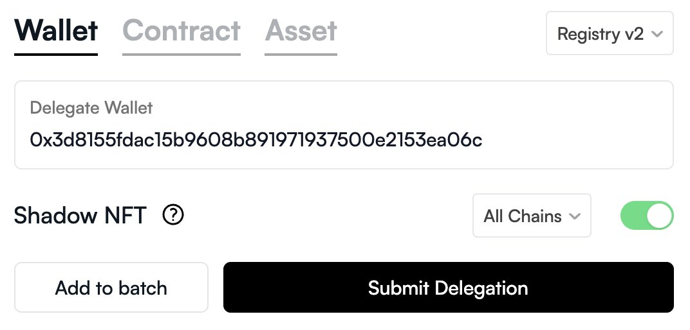

import { Callout } from 'nextra/components'

# Shadow Delegation

- Delegating your NFT is handled via [delegate.xyz](https://delegate.xyz/). For shadows to work via [delegate.xyz](https://delegate.xyz/) you need to click the "Shadows NFT" option to trigger your shadow NFT's movement as well as "all chains" or "Apechain".

- If you just perform a regular delegation on delegate.xyz, then this wouldn't have any effect on shadow ownership.
- If you do not issue a shadow delegation, your shadow (soulbound) will exist in the same wallet as the underlying asset.
- If you do issue a shadow delegation, the shadow will move to that delegated wallet.
- If you have multiple shadow delegations, asset ownership is determined by specificity first (token delegation overrides contract delegation overrides wallet delegation), and ties are broken by recency (newest wins).